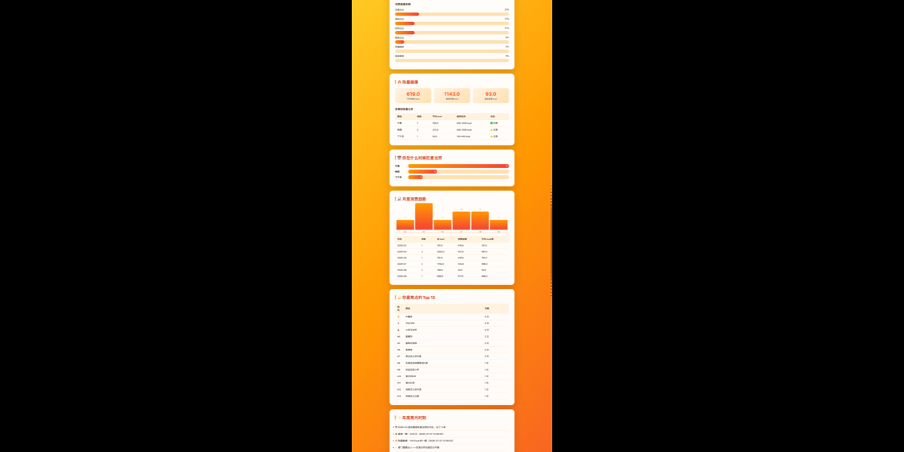
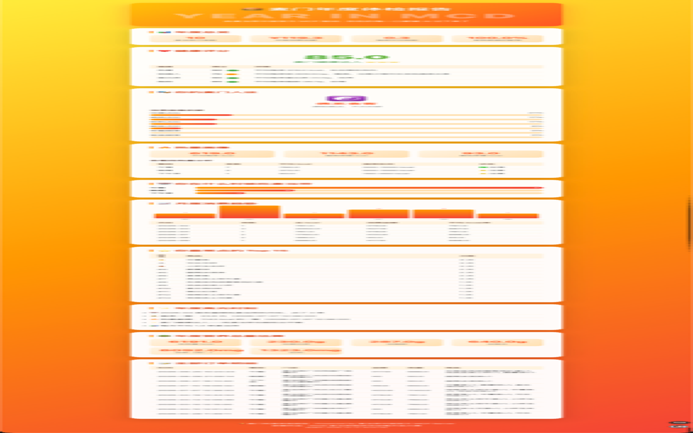
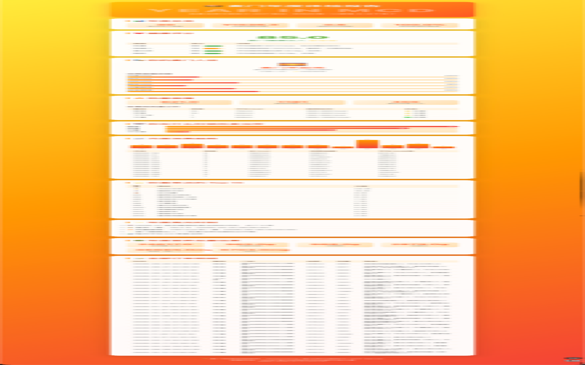

# 🍔 麦门年度体检报告

> **Powered by 麦当劳中国官方 MCP Server** · 2026 麦当劳程序员创意开发大赛参赛作品

<p align="center">
  <a href="https://xiewengi.github.io/mcd-annual-report/" target="_blank">
    
  </a>
</p>

<p align="center">
  <a href="https://xiewengi.github.io/mcd-annual-report/" target="_blank">🚀 在线 Demo（示例报告）</a>
  ·
  <a href="https://xiewengi.github.io/mcd-annual-report/real_report.html" target="_blank">📊 真实数据预览</a>
  ·
  <a href="https://github.com/xiewengi/mcd-annual-report/topics">🏷️ GitHub Topics</a>
</p>

你的每一次麦当劳下单，AI 都替你记着。这份报告把你过去一年的麦当劳消费翻个底朝天——从订单拉取、营养匹配、热量分析到健康评分，一键生成专属年度体检报告。

## 🖼️ 报告预览

<p align="center">
  
</p>

<p align="center">
  
</p>

## ✨ 能做什么

| 功能 | 说明 |
|---|---|
| 📋 **全量历史订单拉取** | 调用 `order-list` 获取全部麦当劳消费记录 |
| 🥗 **营养数据匹配** | 调用 `list-nutrition-foods`，把每单商品精确匹配到热量、蛋白质、脂肪、钠等营养数据 |
| 🔥 **热量画像** | 每单平均热量、最高单餐、各餐段（早/午/下午茶/晚/宵夜）热量分析+推荐区间对比 |
| ❤️ **健康评分** | 从热量、钠摄入、蛋白质、脂肪四个维度计算百分制评分，给出年度健康评级 |
| 🎭 **麦门人设** | 根据消费模式自动判断——脆皮鸡肉爱好者？汉堡收藏家？深夜麦客？ |
| 📊 **月度趋势** | 柱状图展示每月麦当劳消费频次、总热量、金额 |
| ⭐ **Top 15 最爱** | 你最常点的商品排行 |
| ✨ **年度高光** | 最热月份、最贵一餐、热量巅峰……一键总结 |

## 🛠️ 技术栈

- **麦当劳官方 MCP Server**：`https://mcp.mcd.cn`（Streamable HTTP 协议）
- **纯 Python 3 标准库**：零外部依赖，即插即用
- **HTML 报告**：自包含、离线可看、支持手机浏览

## 🚀 快速开始

### 1. 申请 MCP Token

前往 [open.mcd.cn/mcp](https://open.mcd.cn/mcp) 手机号登录 → 控制台 → 一键申请 Token。

### 2. 克隆并运行

```bash
git clone https://github.com/YOUR_USERNAME/mcd-annual-report.git
cd mcd-annual-report

# 用真实数据生成
python3 generate_report.py --token "YOUR_MCD_TOKEN" --save-json

# 或用示例数据体验（无需 Token）
python3 generate_report.py --use-sample --save-json
```

### 3. 查看报告

打开生成的 `output/annual_report.html`——就是你的麦门年度体检报告！

## 📁 项目结构

```
mcd-annual-report/
├── mcd_client.py          # 麦当劳 MCP 客户端（JSON-RPC 封装）
├── analyzer.py             # 核心分析引擎（营养匹配 + 健康评估 + 人设判定）
├── generate_report.py      # 主程序 + HTML 报告生成器
├── data/                   # 数据目录
└── output/                 # 输出目录
    ├── annual_report.html  # 生成的 HTML 报告
    └── report_data.json    # 结构化分析数据
```

## 🔌 麦当劳 MCP 工具调用

本项目用到了麦当劳 MCP 的以下工具：

| 工具 | 用途 |
|---|---|
| `order-list` | 拉取全部历史订单 |
| `list-nutrition-foods` | 获取麦当劳商品营养成分表 |

完整工具列表见 [官方仓库](https://github.com/M-China/mcd-mcp-server)。

## 📊 报告示例

报告包含以下板块：

1. 🍔 **HERO 封面**：年度主题 + 报告生成时间
2. 📊 **年度总览**：订单数、总消费、每周频次、营养匹配率
3. ❤️ **健康评分**：四维度评分条 + 综合评级（麦门健康达人 / 稳健选手 / 谨慎食客 / 放纵战士）
4. 🎭 **麦门人设**：emoji + 人设描述 + 消费画像拆解（汉堡占比、宵夜频率等）
5. 🔥 **热量画像**：平均/最高/最低单餐 + 各餐段热量与推荐区间对比
6. 📅 **餐段分布**：早/午/下午茶/晚/宵夜的下单频次
7. 📈 **月度趋势**：柱状图 + 详细表格
8. ⭐ **Top 15 最爱**：高频商品排行
9. ✨ **年度高光**：最热月份、最贵一餐、热量巅峰等
10. 🥗 **年度营养总量估算**：全部麦当劳带来的热量/蛋白质/脂肪/钠总和
11. 📝 **订单明细**：全部历史订单一览表

## 🏆 参赛信息

- **参赛大赛**：2026 麦当劳程序员创意开发大赛
- **核心命题**：基于麦当劳中国官方 MCP，开发一个创意 Skill
- **本项目定位**：**反向分析类作品**——不是"今天吃什么"，而是"你这一年吃了什么"

### 与已有作品的差异

| 已有作品方向 | 本项目差异 |
|---|---|
| 点餐推荐/隐藏菜单 | 反向分析（历史数据→洞察） |
| 实时营养计算 | 年度维度汇总 + 人设判定 |
| 单次决策辅助 | 跨时间维度的体检报告 |

## 📝 注意事项

- 本项目仅调用麦当劳 MCP 的**只读查询类接口**（订单、营养），不涉及下单/领券等操作
- MCP Token 限个人使用，每分钟 600 次请求限制
- 营养匹配采用模糊匹配策略，部分新品/限定品可能无法精确匹配，报告末尾会显示匹配率

## 🙏 致谢

- 麦当劳中国官方 MCP Server 团队
- 腾讯 WorkBuddy 联合大赛主办方

---

🍟 **麦门永不为奴！**
